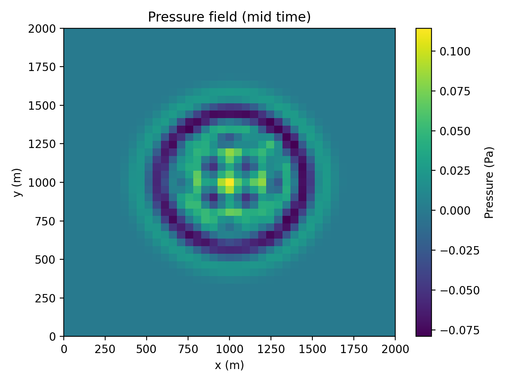
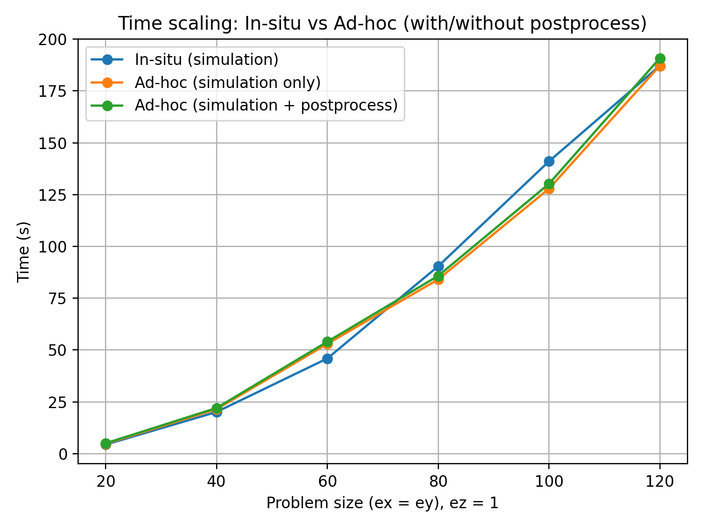
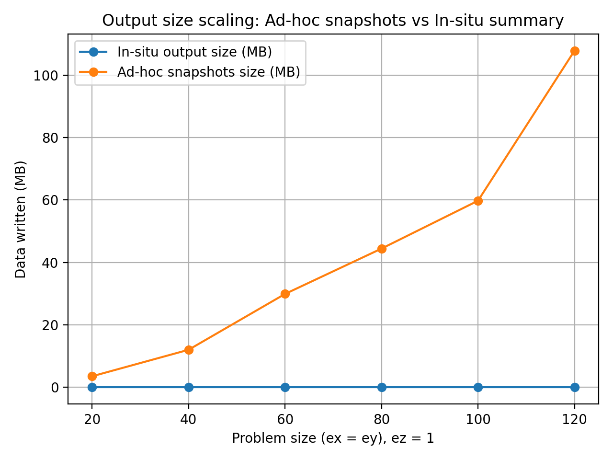
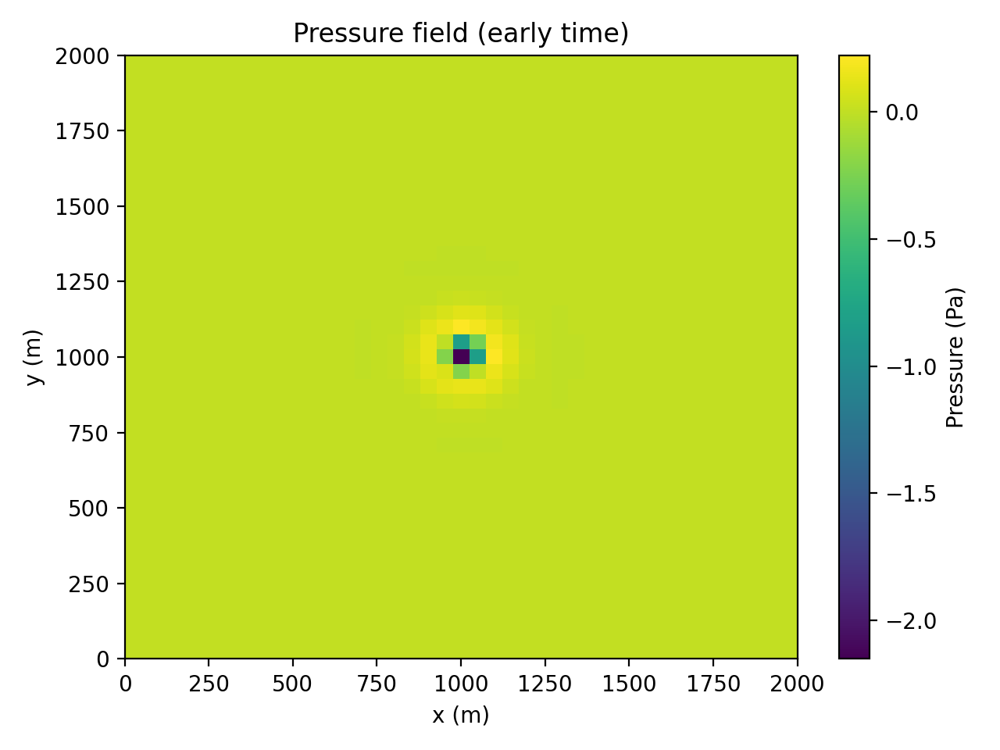
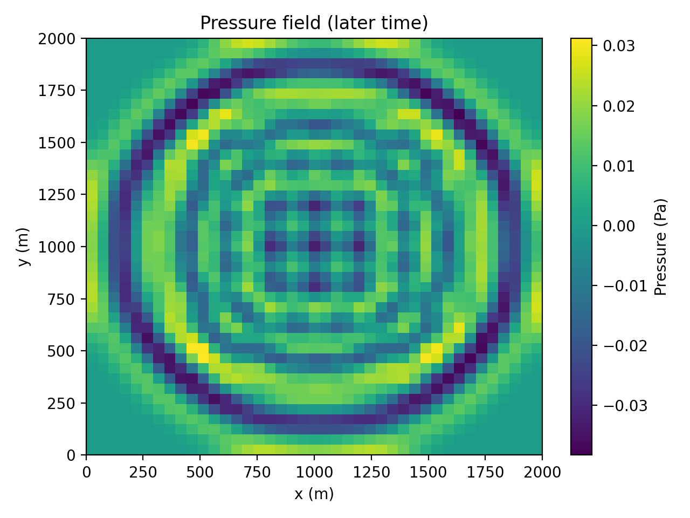

# FUnTiDES In-Situ

In-situ analysis for a spectral-element acoustic wave simulator: pressure statistics and seismogram summaries are computed while the simulation runs, instead of dumping full snapshots to disk and post-processing them afterwards.

School project (ENSEIRB-MATMECA, final year, Nov 2025 - Jan 2026) by a team of three students (see [Authors](#authors)).

> **Based on [FUnTiDES](https://github.com/FUnTiDES-sim/FUnTiDES)** (Fast Unstructured Time Dynamic Equation Solver). FUnTiDES is a C++/Kokkos proxy application that solves the 2nd-order acoustic wave equation with the Spectral Element Method (SEM) and Finite Differences (FD). Everything listed under [Original FUnTiDES code](#original-funtides-code) comes from that project. This repository adds the analysis layer described under [What our team added](#what-our-team-added).



## Original FUnTiDES code

Unchanged from the base code (apart from the build default noted below):

- SEM and FD solvers, finite-element kernels, Cartesian structured and unstructured mesh builders (`src/discretization/`, `src/model/`, `src/solver/`, `src/utils/`)
- The `semproxy` and `fdproxy` drivers, the source and receiver handling, the base command-line options (mesh size, order, `--dt`, `--timemax`, ...)
- The CMake build system with optional Kokkos (OpenMP/Serial/CUDA) or `std::vector` data containers

## What our team added

The team's changes are in the SEM proxy (`src/main/fe/`) and in the scripts at the repository root. The goal was to compare two ways of analysing the pressure field:

- **ad-hoc**: write full snapshots to disk, then compute statistics in Python;
- **in-situ**: compute the same statistics inside the time loop and write only a few numbers.

### Simulation features (C++)

| Feature | CLI options | Output |
|---|---|---|
| Ad-hoc pressure snapshots: full field (`x y z p` per node) every *N* steps | `--save-snapshots`, `--snapshot-interval N`, `--snapshot-folder DIR` | `DIR/snapshot_XXXXXX.dat` |
| In-situ pressure statistics every *N* steps. **full** mode: min, max, mean, variance, energy (sum of p²). **light** mode: mean(p) and mean(p²) only | `--pressure-insitu`, `--pressure-stats-interval N`, `--pressure-stats-file FILE`, `--pressure-insitu-mode full\|light` | CSV, one line per sampled step |
| Seismograms: pressure time series at the mesh nodes listed in `sismos/sismos_pos.csv` | `--save-sismos`, `--sismos-input-file`, `--sismos-folder` | `sismos/logs_adhoc/sismo_*.csv` (one per probe) |
| In-situ seismograms: total energy, min and max per probe, accumulated during the run | `--save-sismos-insitu` | `sismos/logs_insitu/sismos_insitu_summary.csv` |
| Performance metrics: compute time, output time, bytes written (snapshot and seismogram folders), mesh size | always on | `snapshot_metrics/metrics.json` (one entry appended per run) |

### Scripts (Python and Bash)

| Script | Role |
|---|---|
| `postprocess_snapshots_stats.py` | Ad-hoc counterpart of the in-situ **full** mode: min/max/mean/variance/energy from the snapshot files |
| `postprocess_snapshots_light.py` | Ad-hoc counterpart of the in-situ **light** mode: mean(p) and mean(p²) |
| `sismos/sismos_stats_adhoc.py` | Ad-hoc counterpart of the in-situ seismograms: energy, min and max for each `sismo_*.csv` file |
| `exp1.sh` | One run with snapshots (20 x 20 x 20) |
| `exp2.sh` | Ad-hoc (snapshots + `postprocess_snapshots_stats.py`) vs in-situ full, for N = 20 to 120; writes `exp2_scaling_<date>/results.csv` |
| `exp3.sh` | Same campaign with the light mode (snapshots + `postprocess_snapshots_light.py` vs `--pressure-insitu-mode light`) |
| `test.sh` | One ad-hoc vs in-situ (light) comparison at N = 100 |
| `plot_exp2.py` | Time and data-volume scaling plots from a `results.csv` |
| `compare_approach.py` | Time comparison plot from a `results.csv` |
| `plot_snapshot.py` | Pressure field on the mid-plane at three time steps (after `exp1.sh`) |
| `visu2snapshot.py` | Grid of every snapshot in a folder, with a common color scale |

The ad-hoc and in-situ results agree: on a 20 x 20 x 1 test case, the statistics from both workflows match to 1e-6, in both full and light modes and for the seismograms.

## Results

Mesh of `N x N x 1` elements, order 2, `dt = 1 ms`, 1.5 s simulated, statistics every 50 steps (`exp2.sh`, one run per point):

| Time to solution | Data written to disk |
|---|---|
|  |  |

On these small, almost 2D meshes, the in-situ statistics cost about as much as writing snapshots: the time differences are within run-to-run noise. The real gain is storage. At N = 120, the ad-hoc workflow writes over 100 MB of snapshots, while the in-situ run writes a CSV of a few kilobytes. The right-hand plot counts only the snapshot and seismogram folders, so the in-situ curve shows zero.

Pressure field from the snapshots (`exp1.sh` + `plot_snapshot.py`, 20 x 20 x 20 elements, mid-plane):

| Early | Mid | Late |
|---|---|---|
|  |  |  |

## Tech stack

C++17, Kokkos (OpenMP and Serial backends), CMake, cxxopts, Bash, Python (NumPy, pandas, Matplotlib).

## Getting started

### Prerequisites

- CMake >= 3.20 and a C++17 compiler (GCC)
- Python 3 with `numpy`, `pandas` and `matplotlib` for the post-processing and plots (`pip install -r requirements.txt`)

### Build

Kokkos is a Git submodule (`external/kokkos`) and is built with the project:

```sh
git clone --recurse-submodules <this-repo>
cd funtides-insitu
cmake -S . -B build -DCMAKE_BUILD_TYPE=Release
make -C build -j4
```

Kokkos is the default backend. The `std::vector` backend from the base code can still be selected with `-DUSE_VECTOR=ON`, but it gives a zero pressure field in our tests (already the case in the original code).

The scripts expect the binary at `./build/bin/semproxy` and must be launched from the repository root.

### Run

```sh
# Plain SEM simulation, 20 x 20 x 1 elements
./build/bin/semproxy --ex 20 --ey 20 --ez 1

# In-situ pressure statistics every 50 steps (full mode; add --pressure-insitu-mode light for the light mode)
./build/bin/semproxy --ex 20 --ey 20 --ez 1 --pressure-insitu \
  --pressure-stats-interval 50 --pressure-stats-file pressure_insitu.csv

# Ad-hoc: snapshots, then the same statistics in Python
./build/bin/semproxy --ex 20 --ey 20 --ez 1 --save-snapshots \
  --snapshot-interval 50 --snapshot-folder snapshots
python3 postprocess_snapshots_stats.py --snapshots snapshots --out pressure_adhoc_stats.csv
python3 postprocess_snapshots_light.py --snapshots snapshots --out pressure_adhoc_light.csv
python3 visu2snapshot.py snapshots

# Seismograms at the nodes listed in sismos/sismos_pos.csv
./build/bin/semproxy --ex 20 --ey 20 --ez 1 --save-sismos
./build/bin/semproxy --ex 20 --ey 20 --ez 1 --save-sismos-insitu
python3 sismos/sismos_stats_adhoc.py logs_adhoc
```

`./build/bin/semproxy --help` lists all options.

To run the experiments: `./exp2.sh`, then `python3 plot_exp2.py --results exp2_scaling_<date>/results.csv`. A full `exp2.sh` or `exp3.sh` campaign takes around 15 minutes.

## Authors

Arthur Dufetrelle, together with two fellow ENSEIRB-MATMECA students.

## License

This project is a modified version of [FUnTiDES](https://github.com/FUnTiDES-sim/FUnTiDES) and is distributed under the same **CeCILL-C** license ([LICENCE.md](LICENCE.md), French version [LICENCE_fr.md](LICENCE_fr.md)). As stated in Articles 8 and 9 of that license, the software is provided with limited warranty and limited liability.

Modifications made by the project team (Arthur Dufetrelle and two fellow students) between November 2025 and January 2026, and when preparing this repository for publication (October 2026).

**Modified files**

- `src/main/fe/src/sem_proxy.cc`: snapshots, in-situ pressure statistics (full/light), seismograms (time series and in-situ summary), performance metrics
- `src/main/fe/include/sem_proxy.h`: the corresponding members and methods
- `src/main/fe/include/sem_proxy_options.h`: the new command-line options
- `src/main/fe/src/main.cc`: comment only
- `CMakeLists.txt`: minimum CMake version lowered to 3.20
- `cmake/CheckOptions.cmake`: Kokkos instead of `std::vector` when no backend is selected
- `.gitignore`, `requirements.txt`, `README.md`

**Added files**

- `exp1.sh`, `exp2.sh`, `exp3.sh`, `test.sh`
- `postprocess_snapshots_stats.py`, `postprocess_snapshots_light.py`, `plot_exp2.py`, `compare_approach.py`, `plot_snapshot.py`, `visu2snapshot.py`
- `sismos/sismos_pos.csv`, `sismos/sismos_stats_adhoc.py`
- `docs/` (result plots)

`external/cxxopts/cxxopts.hpp` is distributed under the MIT license, and Kokkos (submodule) under its own license.
